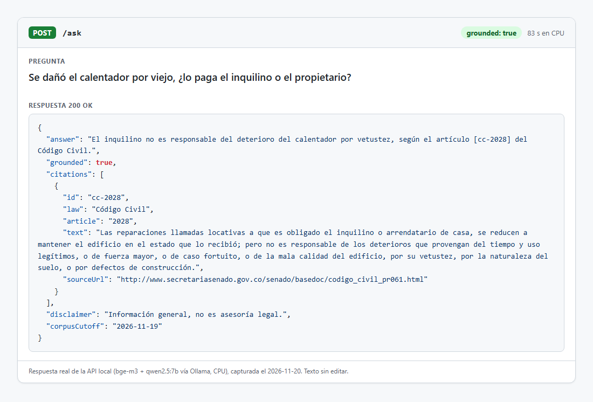
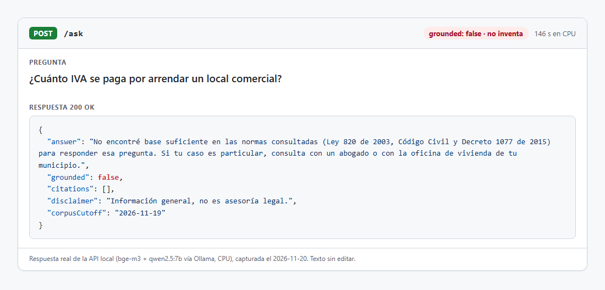
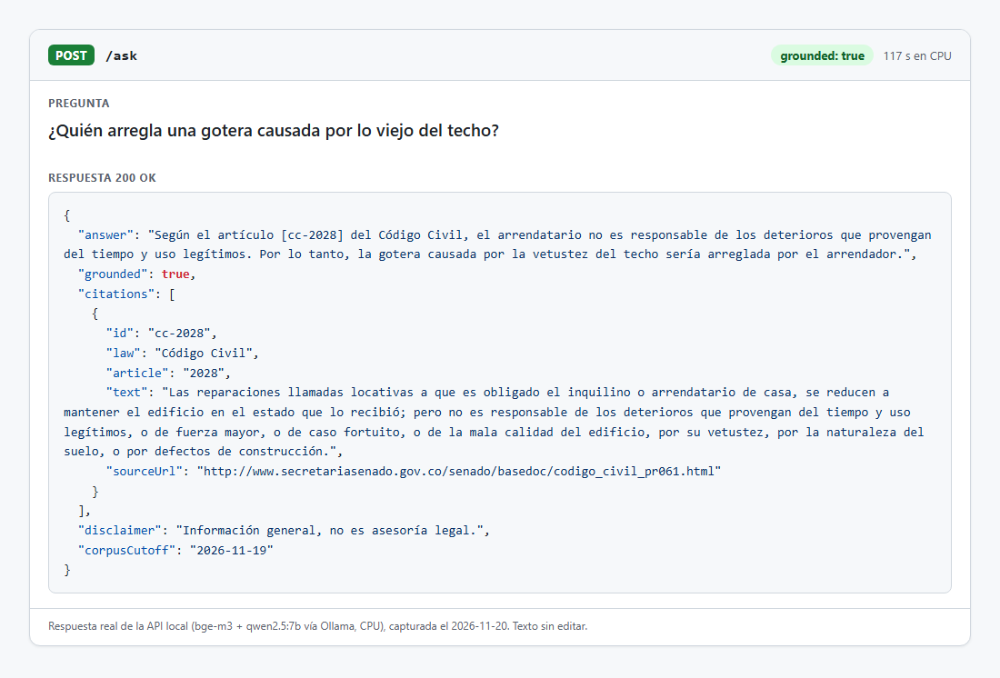
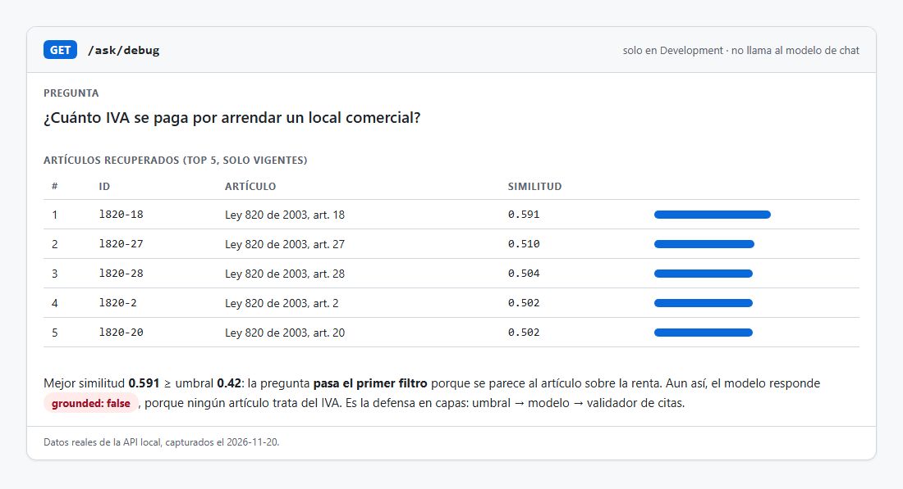
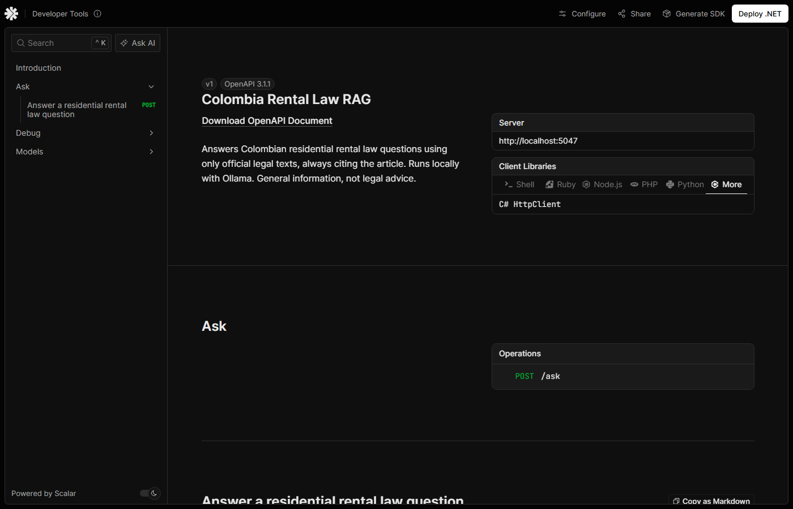
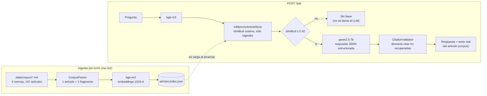

# colombia-rental-law-rag

[](https://github.com/juancitowillyr46/colombia-rental-law-rag/actions/workflows/ci.yml)
[](LICENSE)

Asistente RAG que responde dudas de arrendamiento de vivienda urbana en Colombia, sobre todo **quién paga una reparación**, usando solo textos legales oficiales y **citando siempre el artículo**.

> **Se ejecuta localmente bajo demanda con Ollama.** No hay despliegue en la nube ni claves de API.

## Demo

Respuestas reales de la API local, sin editar (`bge-m3` + `qwen2.5:7b`, en CPU).

**Palabras cotidianas: "calentador" no aparece en la ley, pero encuentra el artículo correcto.** El `answer` lo redacta el modelo; el `text` de la cita sale del corpus.



**Sin base: no inventa.** Ningún artículo del corpus trata del IVA, así que responde que no encontró base y no cita nada.



<details>
<summary>Más capturas: pregunta clara, depuración de la recuperación y documentación interactiva</summary>

**Pregunta clara:**



**Por qué se rechazó la pregunta del IVA** (`GET /ask/debug`): pasa el umbral de similitud, pero el modelo marca `grounded: false`.



**Documentación interactiva con Scalar** en `http://localhost:5047/scalar` (solo en Development):



</details>

## La regla de oro

**El modelo redacta; el código decide qué es válido.**

- Una cita solo llega al usuario si el artículo **se recuperó** para esa pregunta y **está vigente**.
- El texto citado **siempre sale del corpus**, nunca de lo que escribió el modelo.
- Si la búsqueda no encuentra base suficiente, el asistente dice *"No encontré base…"* **sin llamar al modelo de chat**.

## Arquitectura



| Proyecto | Responsabilidad |
|---|---|
| [`RentalLawAssistant.Core`](src/RentalLawAssistant.Core) | Corpus, índice, recuperación, generación y validación. Sin dependencias de ASP.NET Core. |
| [`RentalLawAssistant.Ingestion`](src/RentalLawAssistant.Ingestion) | Consola: parsea el corpus, genera embeddings (solo de lo que cambió) y escribe el índice. |
| [`RentalLawAssistant.Api`](src/RentalLawAssistant.Api) | Minimal API delgada: `POST /ask`, `GET /ask/debug`, OpenAPI y Scalar. |
| [`RentalLawAssistant.Evals`](tools/RentalLawAssistant.Evals) | Consola de evaluaciones: métricas de recuperación y de respuesta, en Markdown. |
| [`RentalLawAssistant.Tests`](tests/RentalLawAssistant.Tests) | xUnit + `WebApplicationFactory`, con dobles de prueba de `IChatClient` e `IEmbeddingGenerator`: el CI no necesita Ollama. |

**Stack:** .NET 10 · ASP.NET Core Minimal API · Microsoft.Extensions.AI · Ollama (OllamaSharp) · `System.Numerics.Tensors` · xUnit · OpenAPI + Scalar.

## Decisiones técnicas

**1. Fragmentación por artículo.** Un artículo es la unidad que se cita, así que cada vector representa exactamente lo que se va a citar. Los artículos de más de ~1.500 caracteres se parten **por incisos completos** (`l820-15#1`, `l820-15#2`…) y todos los trozos comparten el mismo `ArticleId`: la cita apunta al artículo entero, con su texto completo. Al vectorizar se antepone *"Ley 820 de 2003, artículo 15."* para que cada trozo sepa a qué artículo pertenece.

**2. Validación de citas en código.** El modelo devuelve JSON estructurado (`GetResponseAsync<ModelAnswer>`) con los IDs que citó. [`CitationValidator`](src/RentalLawAssistant.Core/Answering/CitationValidator.cs) descarta todo ID que no esté entre los artículos recuperados y vigentes, y el texto de cada cita se toma del índice. Está probado con un `IChatClient` falso que inventa citas: ninguna llega a la respuesta.

**3. Umbral de recuperación calibrado con datos.** Con las 40 preguntas de ajuste, la pregunta válida con menor similitud tiene 0,439 y la pregunta sin base con mayor similitud tiene 0,641: los rangos se cruzan y **ningún umbral los separa solo**. Por eso `MinSimilarity = 0,42` funciona como **primer filtro** de lo claramente ajeno (bloquear una pregunta válida es irreparable), y el modelo (`grounded: false`) más el validador son el segundo y tercer filtro. Con el umbral solo se rechaza bien el 80 %; de punta a punta, el 95 %.

**4. Índice en un archivo, búsqueda en memoria.** La ingesta guarda los embeddings con el SHA-256 de cada fragmento: la segunda ingesta reutiliza los 120 vectores en 0,5 s en vez de 219 s. La API carga el índice al arrancar y **no arranca** si se construyó con otro modelo de embeddings. `IArticleStore` es una interfaz propia para cambiarla por PostgreSQL + pgvector en la etapa 2 sin tocar la API.

**5. Corpus con vigencia verificada.** Cada artículo se revisó contra las notas de vigencia de la fuente oficial: 6 derogados quedan marcados y nunca se citan, y las partes declaradas inexequibles se omiten. Los epígrafes y notas editoriales de los portales (protegidos por derechos de autor) no se reproducen. Detalle en [`data/corpus/SOURCES.md`](data/corpus/SOURCES.md).

## Evaluaciones

60 preguntas en [`evals/questions.json`](evals/questions.json): 40 de **ajuste** y 20 de **prueba**. Mezclan preguntas claras, palabras cotidianas que no están en la ley ("calentador", "chapa", "bisagra"), preguntas fuera del corpus que deben rechazarse y preguntas sobre artículos derogados.

Las de prueba se escribieron y [se subieron](https://github.com/juancitowillyr46/colombia-rental-law-rag/commit/f26d15c) **antes de ajustar nada**, solo corren con `--final` y se midieron **una sola vez**, al final.

**Resultado final** (`bge-m3` + `qwen2.5:7b`, `MinSimilarity` 0,42; [reporte completo](evals/results/final-qwen2.5-7b.md)):

| Métrica | Ajuste (40) | Prueba (20) |
|---|---|---|
| Hit rate@5 (el artículo esperado está entre los 5 recuperados) | 94 % | **93 %** |
| Recall@5 | 80 % | **83 %** |
| MRR | 0,72 | **0,66** |
| Rechazo correcto, solo umbral | 80 % | **70 %** |
| Rechazo correcto, de punta a punta | 95 % | **80 %** |
| Precisión de citas | 77 % | **53 %** |
| Citas inventadas que llegaron al usuario | 0 | **0** |
| Latencia media por respuesta (CPU) | 36 s | 64 s |

**Comparación de modelos de chat** (solo con las preguntas de ajuste; [3b](evals/results/tuning-full-qwen2.5-3b-prompt-v1.md), [7b](evals/results/tuning-full-qwen2.5-7b-prompt-v1.md)):

| Métrica | `qwen2.5:3b` | `qwen2.5:7b` |
|---|---|---|
| Rechazo correcto, de punta a punta | 90 % | **93 %** |
| Precisión de citas | 62 % | **73 %** |
| Preguntas fallidas | 13 | **7** |
| Latencia media | **30 s** | 70 s |

Se eligió `qwen2.5:7b`: el `3b` llegó a inventar un dato (el salario mínimo) citando un artículo real, y a invertir quién paga una instalación eléctrica vieja.

### Qué dicen estos números

- **La recuperación generaliza**: con preguntas nuevas, el hit rate pasa de 94 % a 93 %.
- **La generación no generaliza igual**: rechazo de 95 % a 80 % y precisión de citas de 77 % a 53 %. El ajuste del prompt sobre las preguntas de ajuste no se trasladó del todo.
- **La regla de oro se cumplió en las 60 preguntas**, pero tiene un límite claro: garantiza que la cita es real y fue recuperada, **no que el razonamiento sea correcto**. Ejemplo real de la prueba: ante *"somos dos inquilinos y mi compañero no pagó, ¿me pueden cobrar todo a mí?"*, el modelo respondió *"No"* citando el art. 14 de la Ley 820, cuando el art. 7 dice que las obligaciones son solidarias.
- **Con 40 o 20 preguntas, una sola pregunta mueve las métricas entre 2,5 y 5 puntos**; las diferencias pequeñas son ruido.

## Cómo correrlo

**Requisitos:** [.NET 10 SDK](https://dotnet.microsoft.com/download) y [Ollama](https://ollama.com).

```powershell
# 1. Modelos (una vez)
ollama pull bge-m3
ollama pull qwen2.5:7b          # o qwen2.5:3b, más rápido y menos preciso

# 2. Construir el índice (unos 4 minutos en CPU la primera vez; luego, segundos)
dotnet run --project src/RentalLawAssistant.Ingestion

# 3. Levantar la API: abre la documentación interactiva en http://localhost:5047/scalar
dotnet run --project src/RentalLawAssistant.Api
```

También puedes probar con [`RentalLawAssistant.Api.http`](src/RentalLawAssistant.Api/RentalLawAssistant.Api.http) desde VS Code, o ver qué artículos se recuperan y con qué similitud en `GET /ask/debug?question=…` (solo en Development).

```powershell
dotnet test                                                         # 103 pruebas, sin Ollama
dotnet run --project tools/RentalLawAssistant.Evals -- --retrieval-only   # métricas de recuperación (rápido)
dotnet run --project tools/RentalLawAssistant.Evals                       # de punta a punta, solo ajuste
dotnet run --project tools/RentalLawAssistant.Evals -- --Ollama:ChatModel=qwen2.5:3b   # comparar modelos
```

La configuración está en `appsettings.json` (`Ollama`, `Retrieval`, `Corpus`) y se valida al arrancar.

## Corpus

| Norma | Alcance | Artículos |
|---|---|---|
| Código Civil | Título XXVI, capítulos I a V (arts. 1973–2035) | 63 (1 derogado) |
| Ley 820 de 2003 | Completa | 43 (5 derogados) |
| Decreto 1077 de 2015 | Art. 2.2.6.1.1.10 (reparaciones locativas) | 1 |

Fecha de corte: **19 de noviembre de 2026**. Fuentes, fechas de descarga y criterios en [`SOURCES.md`](data/corpus/SOURCES.md).

## Roadmap

- [x] **Etapa 1, fase 1 – Recuperación:** corpus, ingesta con reutilización de embeddings, búsqueda en memoria, umbral.
- [x] **Fase 2 – Respuestas:** salida estructurada, validación de citas, `POST /ask`, OpenAPI y Scalar.
- [x] **Fase 3 – Evaluaciones:** 60 preguntas, calibración del umbral, comparación de modelos, medición final.
- [ ] **Fase 4 – Portafolio:** CI y README con capturas de la demo listos; falta la release `v0.1.0`.
- [ ] **Etapa 2, fase 5 – PostgreSQL + pgvector:** índice HNSW, ingesta idempotente y **búsqueda híbrida** (vectores + texto completo en español) como `PostgresArticleStore` de la misma interfaz. Se queda solo si mejora las evaluaciones frente a la `v0.1.0`.
- [ ] **Mejoras medidas por las evaluaciones:** fidelidad con un LLM como juez; un filtro de alcance para preguntas parecidas a un tema del corpus pero fuera de él (crédito hipotecario, registro de empresas).
- [ ] **Fase 6 – Integración:** un bot de WhatsApp de incidentes para inmobiliarias llama a `/ask` para sugerir quién paga cada daño.

## Aviso

**Información general, no es asesoría legal.** El asistente puede equivocarse; ante un caso concreto, consulta con un abogado o con la oficina de vivienda de tu municipio.

## Licencia

[MIT](LICENSE)
